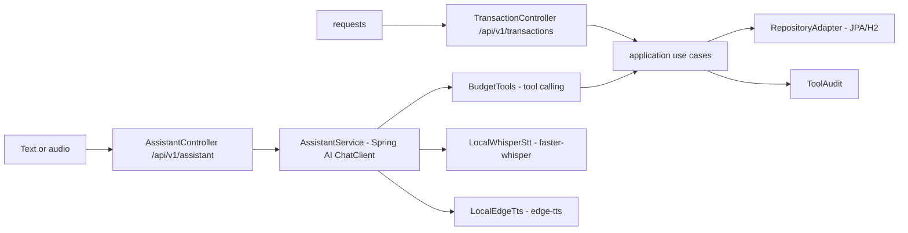

# kodabudget-api

**English** · [Português (Brasil)](README.md)

[](https://adoptium.net/) [](https://spring.io/projects/spring-boot) [](#) [](https://maven.apache.org/) [](#.github/workflows/ci.yml) [](LICENSE)

## What it is

A personal budget API built with **clean (hexagonal) architecture** plus an AI-driven financial assistant: the user talks by **text or voice** and the model takes real actions (logging spending, listing transactions, monthly summary) through **tool calling** on Spring AI. Voice input uses **faster-whisper** (local Python STT) and spoken replies use **edge-tts**.

## Status

A working, tested API (6 tests). The core (voice input, tool calling) is a technical demonstration; the conversation depends on an OpenAI key (or local mode).

## Features

- **Text assistant** (`POST /api/v1/assistant/chat`): chat with a financial persona that runs tools.
- **Voice assistant** (`POST /api/v1/assistant/voice`): upload an audio file (multipart) transcribed by faster-whisper.
- **Voice with spoken reply** (`POST /api/v1/assistant/voice/audio`): transcription + reply and returns audio generated by edge-tts.
- **Tool calling**: the AI calls 3 domain tools — `createTransaction`, `listTransactions` and `monthlySummary` — without ever touching persistence directly.
- **Tool audit** (`GET /api/v1/assistant/audit`): a timestamped record of every tool call.
- **Transaction CRUD** (`/api/v1/transactions`) with a monthly summary.
- **Persistence** via JPA with H2 (local file, PostgreSQL mode).
- **Docs** via springdoc (Swagger UI) and an **H2 console**.

## Architecture

Clean architecture in layers:
- `application/` — use cases (CreateTransaction, ListTransactions, MonthlySummary) and commands
- `domain/` — entities, categories and the `TransactionRepository` contract
- `infrastructure/` — web (controllers), persistence (JPA adapter), AI (`AssistantService` + `BudgetTools`) and voice (Whisper/edge-tts)
- `AssistantService` orchestrates the Spring AI `ChatClient` with the tools registered on it.



## Stack

- Java 21, Spring Boot 3.5.16
- Spring Web, Spring Data JPA, Spring Validation
- Spring AI (`spring-ai-starter-model-openai`) — ChatClient + tool calling
- H2 (file, `MODE=PostgreSQL`)
- Springdoc OpenAPI 2.8.17
- Voice: Python `faster-whisper` (STT) and `edge-tts` (TTS), invoked via subprocess
- Maven 3.9, spring-boot-starter-test (JUnit 5)
- CI: GitHub Actions (`ci.yml`, `mvn -B verify` on Temurin JDK 21)

## Repository layout

```
kodabudget-api/
├── pom.xml · mvnw
└── src/main/java/com/kodabudget/
    ├── application/       # use cases and commands
    ├── domain/            # Transaction, Category, TransactionId, Repository
    └── infrastructure/
        ├── ai/            # AssistantService, BudgetTools, ToolAudit
        ├── persistence/   # TransactionJpa + RepositoryAdapter (JPA/H2)
        ├── voice/         # LocalWhisperStt, LocalEdgeTts, bridges
        └── web/           # AssistantController, TransactionController
    └── test/java/com/kodabudget/  # UseCaseTest, ToolAuditTest
```

## Prerequisites and installation

- JDK 21, Maven 3.9+ (or `./mvnw`)
- Python with `faster-whisper` and `edge-tts` installed (for voice)
- (Optional) `OPENAI_API_KEY` for the model; without it the app runs in `local-mode`

```bash
git clone https://github.com/KelvinOliveiraCode/kodabudget-api.git
cd kodabudget-api
```

Environment variables (read in `application.yml`):

| Variable | Default | Use |
|----------|---------|-----|
| `OPENAI_API_KEY` | `local-mode` | OpenAI API key |
| `OPENAI_BASE_URL` | `https://api.openai.com` | Endpoint (for proxies/alternates) |
| `OPENAI_CHAT_MODEL` | `gpt-4o-mini` | Chat model |

## How to run

```bash
./mvnw spring-boot:run
# API at http://localhost:9091
# Swagger UI at http://localhost:9091/docs
# H2 console at http://localhost:9091/h2-console
```

### Endpoints

| Method | Route | Description |
|--------|-------|-------------|
| POST | `/api/v1/assistant/chat` | Text command for the assistant |
| POST | `/api/v1/assistant/voice` | Voice command (audio file, multipart) |
| POST | `/api/v1/assistant/voice/audio` | Voice command with spoken reply (audio) |
| GET | `/api/v1/assistant/audit` | Audit of AI tool calls |
| POST | `/api/v1/transactions` | Registers a transaction |
| GET | `/api/v1/transactions` | Lists transactions |
| GET | `/api/v1/transactions/{id}` | Fetches a transaction by id |

Categories: `FOOD`, `TRANSPORT`, `HOUSING`, `HEALTH`, `EDUCATION`, `ENTERTAINMENT`, `INCOME`, `OTHER`.

Example (text command):

```bash
curl -X POST http://localhost:9091/api/v1/assistant/chat \
  -H "Content-Type: application/json" \
  -d '{"text":"registrei 45.90 em food ontem"}'
```

## Tests and quality

Real command (verified by the agent, Maven 3.9.16 / JDK 21):

```bash
mvn -B test
```

Result: `Tests run: 6, Failures: 0, Errors: 0, Skipped: 0` and `BUILD SUCCESS`.

- UseCaseTest: 5 tests
- ToolAuditTest: 1 test

CI runs `mvn -B verify` on push/PR to `main`.

## Technical decisions and trade-offs

- **Tool calling instead of the model writing to the DB**: the AI only calls tools; persistence stays in the use cases, keeping control and auditability.
- **Local STT/TTS via Python subprocess** instead of SaaS voice servers: no voice API cost, at the expense of requiring the Python environment on the host.
- **H2 file with `MODE=PostgreSQL`**: local simplicity with SQL close to a production Postgres.
- **Configurable base URL and model**: lets you point to OpenAI-compatible providers without code changes.

## Known limitations and roadmap

- The AI conversation needs the OpenAI key; local voice depends on `faster-whisper`/`edge-tts` on the host.
- No authentication/authorization (out of scope for the demonstration).
- H2 file persistence (not a production database).

## Development process

An individual project by Kelvin Oliveira, built with orchestrated AI agents and reviewed by the author. The clean architecture, the Spring AI orchestration and the review are the author's.

## License and author

MIT — Copyright (c) 2026 Kelvin Rebelo de Oliveira.

**Author**: [Kelvin Oliveira](https://github.com/KelvinOliveiraCode) · [Portfolio](https://kelvinoliveiracode.github.io/portfolio/)
