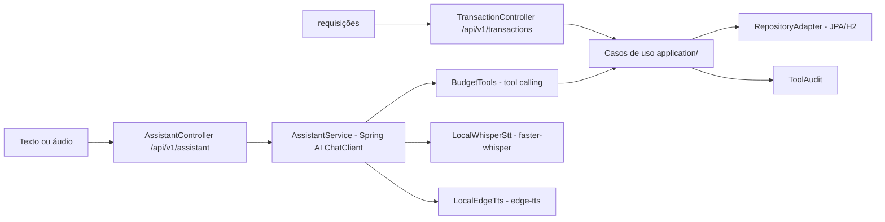

# kodabudget-api

[English](README.en.md) · **Português (Brasil)**

[](https://adoptium.net/) [](https://spring.io/projects/spring-boot) [](#) [](https://maven.apache.org/) [](#.github/workflows/ci.yml) [](LICENSE)

## O que é

API de orçamento pessoal em **arquitetura limpa (hexagonal)** com um assistente financeiro dirigido por IA: o usuário conversa por **texto ou voz** e o modelo executa ações reais (registrar gasto, listar transações, resumo mensal) por **tool calling** via Spring AI. A entrada de voz usa **faster-whisper** (STT local em Python) e a resposta falada usa **edge-tts**.

## Status

API funcional e testada (6 testes). O núcleo (uso de voz, tool calling) é uma demonstração técnica; a conversa depende de uma chave da OpenAI (ou modo local).

## Funcionalidades

- **Assistente por texto** (`POST /api/v1/assistant/chat`): conversa com persona financeira e executa tools.
- **Assistente por voz** (`POST /api/v1/assistant/voice`): envio de arquivo de áudio (multipart) transcrito por faster-whisper.
- **Voz com resposta falada** (`POST /api/v1/assistant/voice/audio`): transcrição + resposta + demora retorna áudio gerado por edge-tts.
- **Tool calling**: a IA chama 3 ferramentas do domínio — `createTransaction`, `listTransactions` e `monthlySummary` — sem nunca acessar a persistência diretamente.
- **Auditoria das tools** (`GET /api/v1/assistant/audit`): registro de cada chamada de ferramenta com timestamp.
- **CRUD de transações** (`/api/v1/transactions`) com resumo mensal.
- **Persistência** JPA com H2 (arquivo local, modo PostgreSQL).
- **Documentação** via springdoc (Swagger UI) e **console H2**.

## Arquitetura

Arquitetura limpa em camadas:
- `application/` — casos de uso (CreateTransaction, ListTransactions, MonthlySummary) e comandos
- `domain/` — entidades, categorias e o contrato `TransactionRepository`
- `infrastructure/` — web (controllers), persistência (JPA adapter), IA (`AssistantService` + `BudgetTools`) e voz (Whisper/edge-tts)
- O `AssistantService` orquestra o `ChatClient` do Spring AI com o registro das tools.



## Stack

- Java 21, Spring Boot 3.5.16
- Spring Web, Spring Data JPA, Spring Validation
- Spring AI (`spring-ai-starter-model-openai`) — ChatClient + tool calling
- H2 (arquivo, `MODE=PostgreSQL`)
- Springdoc OpenAPI 2.8.17
- Voz: Python `faster-whisper` (STT) e `edge-tts` (TTS), chamados via subprocess
- Maven 3.9, spring-boot-starter-test (JUnit 5)
- CI: GitHub Actions (`ci.yml`, `mvn -B verify` na JDK 21 Temurin)

## Estrutura do repositório

```
kodabudget-api/
├── pom.xml · mvnw
└── src/main/java/com/kodabudget/
    ├── application/       # use cases e comandos
    ├── domain/            # Transaction, Category, TransactionId, Repository
    └── infrastructure/
        ├── ai/            # AssistantService, BudgetTools, ToolAudit
        ├── persistence/   # TransactionJpa + RepositoryAdapter (JPA/H2)
        ├── voice/         # LocalWhisperStt, LocalEdgeTts, bridges
        └── web/           # AssistantController, TransactionController
    └── test/java/com/kodabudget/  # UseCaseTest, ToolAuditTest
```

## Pré-requisitos e instalação

- JDK 21, Maven 3.9+ (ou `./mvnw`)
- Python com `faster-whisper` e `edge-tts` instalados (para voz)
- (Opcional) `OPENAI_API_KEY` para o modelo; sem ela o app roda em `local-mode`

```bash
git clone https://github.com/KelvinOliveiraCode/kodabudget-api.git
cd kodabudget-api
```

Variáveis de ambiente (lidas em `application.yml`):

| Variável | Padrão | Uso |
|----------|--------|-----|
| `OPENAI_API_KEY` | `local-mode` | Chave da API da OpenAI |
| `OPENAI_BASE_URL` | `https://api.openai.com` | Endpoint (para proxies/alternativos) |
| `OPENAI_CHAT_MODEL` | `gpt-4o-mini` | Modelo de chat |

## Como executar

```bash
./mvnw spring-boot:run
# API em http://localhost:9091
# Swagger UI em http://localhost:9091/docs
# Console H2 em http://localhost:9091/h2-console
```

### Endpoints

| Método | Rota | Descrição |
|--------|------|-----------|
| POST | `/api/v1/assistant/chat` | Comando em texto para o assistente |
| POST | `/api/v1/assistant/voice` | Comando por voz (arquivo de áudio, multipart) |
| POST | `/api/v1/assistant/voice/audio` | Comando por voz com resposta falada (áudio) |
| GET | `/api/v1/assistant/audit` | Auditoria das chamadas de tools pela IA |
| POST | `/api/v1/transactions` | Registra uma transação |
| GET | `/api/v1/transactions` | Lista as transações |
| GET | `/api/v1/transactions/{id}` | Busca uma transação por id |

Categorias: `FOOD`, `TRANSPORT`, `HOUSING`, `HEALTH`, `EDUCATION`, `ENTERTAINMENT`, `INCOME`, `OTHER`.

Exemplo (comando por texto):

```bash
curl -X POST http://localhost:9091/api/v1/assistant/chat \
  -H "Content-Type: application/json" \
  -d '{"text":"registrei 45.90 em food ontem"}'
```

## Testes e qualidade

Comando real (verificado pelo agente, Maven 3.9.16 / JDK 21):

```bash
mvn -B test
```

Resultado: `Tests run: 6, Failures: 0, Errors: 0, Skipped: 0` e `BUILD SUCCESS`.

- UseCaseTest: 5 testes
- ToolAuditTest: 1 teste

CI roda `mvn -B verify` no push/PR para `main`.

## Decisões técnicas e trade-offs

- **Tool calling em vez de o modelo gravar no banco**: a IA só chama tools; a persistência fica nos use cases, garantindo controle e auditoria.
- **STT/TTS locais via subprocess Python** em vez de servidores SaaS: roda sem custo de API de voz, ao custo de exigir o ambiente Python instalado no host.
- **H2 em arquivo com `MODE=PostgreSQL`**: simplicidade local que aproxima o SQL de um Postgres de produção.
- **Base URL e modelo configuráveis**: permite apontar para provedores OpenAI-compatíveis sem mudança de código.

## Limitações conhecidas e roadmap

- A conversa com IA requer a chave da OpenAI; a voz local depende de `faster-whisper`/`edge-tts` no host.
- Sem autenticação/autorização (fora de escopo da demonstração).
- Persistência H2 em arquivo local (não é um banco de produção).

## Processo de desenvolvimento

Projeto individual de Kelvin Oliveira, construído com agentes de IA orquestrados e revisado pelo autor. A arquitetura limpa, a orquestração com Spring AI e a revisão são do autor.

## Licença e autor

MIT — Copyright (c) 2026 Kelvin Rebelo de Oliveira.

**Autor**: [Kelvin Oliveira](https://github.com/KelvinOliveiraCode) · [Portfólio](https://kelvinoliveiracode.github.io/portfolio/)
